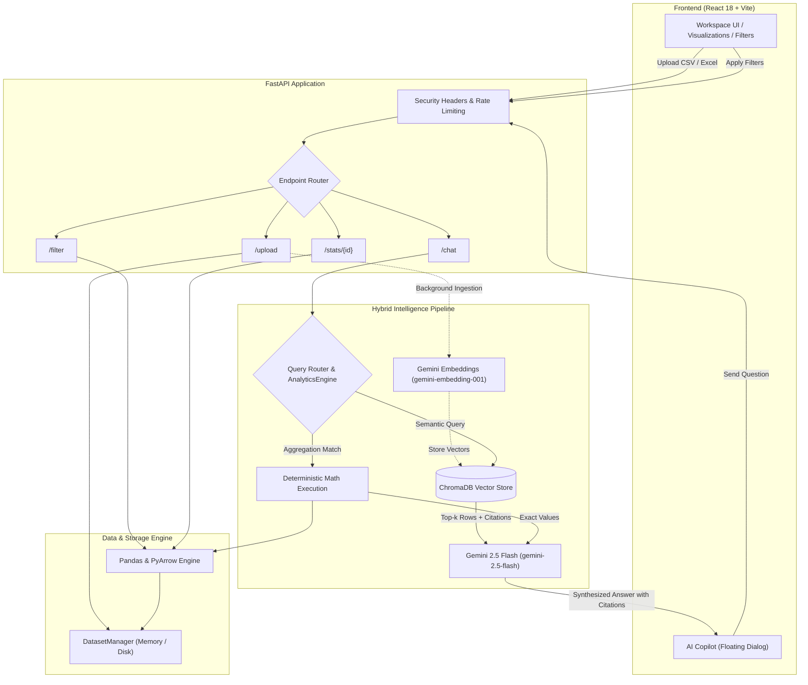

# DataLens Analytics

> Multi-dimensional dataset intelligence platform combining deterministic analytical computing, interactive exploratory dashboards, and citation-backed conversational AI powered by Google Gemini 2.5.

[](https://www.python.org/)
[](https://fastapi.tiangolo.com/)
[](https://react.dev/)
[](https://vitejs.dev/)
[](https://tailwindcss.com/)
[](https://ai.google.dev/)
[](https://www.trychroma.com/)

---

## 1. Project Introduction

**DataLens Analytics** is a full-stack data exploration and analysis platform designed to eliminate the trade-off between statistical accuracy and conversational natural-language querying.

### The Problem It Solves
When analyzing datasets, teams often choose between two extremes:
1. **Traditional BI and spreadsheets**: Accurate and deterministic, but rigid, requiring SQL, formula knowledge, or manual chart building.
2. **Standard Large Language Model (LLM) chats**: Conversational and fast, but prone to arithmetic hallucinations, fabricated row lookups, and security issues when entire datasets are exposed in prompt contexts.

### The DataLens Solution
DataLens bridges this gap through a hybrid architecture:
- **Instant Ingestion**: Users upload CSV or Excel files (`.csv`, `.xlsx`, `.xls`). Files undergo magic-byte signature validation, encoding detection, and defensive schema normalization.
- **Exploratory Workspace**: The dashboard automatically calculates distribution curves, categorical frequencies, missing-value percentages, and correlation matrices rendered via responsive interactive visualizations.
- **Multi-Dimensional Filters**: Users can slice datasets across numerical ranges and categorical values with debounced, out-of-order-protected filtering.
- **Hybrid AI Copilot**: When users ask questions in natural language, the backend routes mathematical aggregations (`sum`, `mean`, `median`, `min`, `max`, grouped counts) directly to an in-memory **Deterministic Analytics Engine** powered by `pandas`. For qualitative questions, pattern analysis, and exploratory inquiries, the system leverages a **Retrieval-Augmented Generation (RAG)** pipeline backed by hosted Google Gemini embeddings (`gemini-embedding-001`) and ChromaDB to synthesize answers with verifiable row citations.

---

## 2. Visual Identity & Art Direction

DataLens Analytics features a bespoke visual identity tailored for data-dense engineering and intelligence workflows:

- **Graphite (`#111215`)**: Deep, low-fatigue workspace foundation with subtle radial accents.
- **Warm Ivory (`#F5F4EF`)**: High-contrast, readable typography and crisp numerical display.
- **Acid Lime (`#D4F237`)**: High-signal intentional accent for active controls, live status badges, and primary callouts.
- **Muted Terracotta (`#E06D53`)**: Reserved warning and negative correlation indicator.

The interface adheres to strict information hierarchy, viewport-anchored dual-scrolling, zero layout shift, and full compliance with `prefers-reduced-motion` accessibility standards.

---

## 3. Core Features

### Data Ingestion & Validation
- **File Format Support**: Ingests `.csv`, `.xlsx`, and `.xls` files up to 50 MB (configurable via `MAX_UPLOAD_MB`).
- **Binary Magic-Byte Inspection**: Validates genuine file signatures (`PK..` for ZIP/XLSX, standard text bounds for CSV) to block MIME spoofing and executable uploads.
- **Encoding Auto-Detection**: Uses `charset_normalizer` to resolve UTF-8, Latin-1, and Windows-1252 character sets.
- **Defensive Schema Parsing**: Flags empty datasets, duplicate column headers, and unparseable rows before state assignment.
- **Curated 1-Click Samples**: Pre-packaged datasets for instant demonstration and onboarding without local files.

### Statistical Analysis & Visualization
- **Health & Completeness Scoring**: Automated calculation of total rows, column dimensions, null cell percentages, duplicate detection, and memory footprint.
- **Descriptive Numerical Statistics**: Mean, standard deviation, minimum, 25th percentile, median, 75th percentile, and maximum values computed for every numeric column.
- **Categorical Frequency Distribution**: Top values and unique cardinality counts.
- **Correlation Matrix**: Bivariate Pearson correlation matrix highlighting strong, moderate, and inverse relationships.
- **Interactive Visualizations**: Dynamic histogram distributions, line trends, scatter plots, and responsive data tables powered by Recharts.

### Interactive Multi-Field Filters
- **Collapsible Sidebar Accordions**: Independent collapse/expand controls for every categorical and numeric field.
- **Range & Value Filtering**: Min/max sliders for numbers, multi-select checkboxes for categories.
- **Active Filter Counter & Removable Chips**: Live pill indicators showing active filter count with single-click individual chip removal and a global `Clear all` reset.
- **Field Search**: Filter-field search input to filter column lists instantly on wide datasets.

### AI Copilot with Hybrid Retrieval & Citations
- **Floating Contextual Dialog**: Anchored viewport copilot accessible from any view via an Acid Lime floating trigger or keyboard shortcut (`Escape` to close).
- **Context-Aware Suggested Questions**: Dynamic prompt suggestions derived from the active dataset's numerical and categorical schema.
- **Deterministic Math Routing**: Intercepts aggregation questions (e.g., *"What is the total revenue in North America?"*) and executes exact pandas computations, returning a distinct **Deterministic Analytics** badge.
- **Semantic RAG Vector Search**: Embeds dataset rows into ChromaDB using Google Gemini Embeddings (`gemini-embedding-001`, 768 dimensions) and retrieves top-k row snippets.
- **Row-Level Citations**: Assistant answers cite verifiable data rows with expandable row indexes and snippets.
- **Session Isolation & State Reset**: Switching or clearing a dataset immediately clears conversation history, aborts pending network queries, and resets state atomically to prevent cross-dataset contamination.

---

## 4. Architecture & Technology Stack

### Technology Summary

| Layer | Technologies & Dependencies | Purpose |
| :--- | :--- | :--- |
| **Frontend** | React 18, Vite 5, Tailwind CSS 3.4, Recharts, Lucide React, React Markdown | Responsive SPA, data visualizations, floating copilot |
| **Backend** | Python 3.11 / 3.13, FastAPI, Uvicorn (Single Worker), Pydantic v2 | High-performance async REST API, validation, routing |
| **Data Engine** | pandas 2.x, NumPy, PyArrow, openpyxl, charset-normalizer | In-memory data parsing, deterministic statistics, filtering |
| **Vector Database** | ChromaDB (Embedded) | Persistent row chunk embedding storage and semantic search |
| **AI & Embeddings** | Google Gemini 2.5 Flash (`gemini-2.5-flash`), Gemini Embeddings (`gemini-embedding-001`) | High-speed LLM reasoning and hosted 768-dim embeddings |
| **Security & Ops** | slowapi, python-json-logger, httpx | Rate limiting, structured logging, secure outbound HTTP |

### Architecture Request Flow



---

## 5. Project Structure

```
DataLens-Analytics/
├── backend/                         # FastAPI backend service
│   ├── app.py                       # Application endpoints, middleware, lifecycle
│   ├── config.py                    # Environment settings bag (Pydantic / os.environ)
│   ├── api_helpers.py               # Dataset parsing, descriptive stats, chat flow
│   ├── dataset_manager.py           # In-memory / disk dataset lifecycle manager
│   ├── security.py                  # Rate limiting, file magic checks, input sanitization
│   ├── logging_config.py            # Structured JSON / human-readable logging setup
│   ├── requirements.txt             # Backend Python dependencies
│   ├── services/
│   │   ├── ai/
│   │   │   ├── embeddings/          # Hosted GeminiEmbeddingService (768-dim)
│   │   │   └── rag/                 # Chunker, retriever, prompt builder, query router
│   │   └── analytics/               # Deterministic pandas AnalyticsEngine
│   └── tests/                       # Pytest test suite (93 tests)
├── frontend/                        # React 18 + Vite frontend application
│   ├── src/
│   │   ├── components/
│   │   │   ├── Brand/               # Visual brand marks and logos
│   │   │   ├── Chatbot/             # AI Copilot floating panel and message cards
│   │   │   ├── Dashboard/           # Overview metrics, charts, data table
│   │   │   ├── Filters/             # Multi-field accordion filters and chip summary
│   │   │   ├── Insights/            # Automated statistical cards and health score
│   │   │   ├── Navigation/          # Header navbar and viewport-anchored sidebar
│   │   │   └── Upload/              # Drag-and-drop hero and sample dataset loader
│   │   ├── context/                 # DataContext (atomic dataset and filter state)
│   │   ├── hooks/                   # useDataset, useChat, useFilters
│   │   ├── utils/                   # apiClient (Axios with robust error extraction)
│   │   ├── App.jsx                  # Root layout, dual-scroll viewport container
│   │   ├── main.jsx                 # Application entry point
│   │   └── index.css                # Tailwind base styles and design system variables
│   ├── package.json                 # Frontend dependencies and scripts
│   ├── tailwind.config.cjs          # Bespoke theme tokens and color palette
│   ├── vite.config.ts               # Vite configuration with local API proxy
│   └── vercel.json                  # Vercel SPA routing and production API rewrites
├── docs/                            # Architecture reports and test evidence
├── render.yaml                      # Render Blueprint specification (Web Service)
├── requirements.txt                 # Root Python requirements alias
└── .env.example                     # Root environment variable template
```

---

## 6. Local Development Setup

Follow these instructions to run both services locally on Windows using PowerShell.

### Prerequisites
- **Python**: Version `3.11+` (tested through `3.13.5`).
- **Node.js**: Version `18.0.0+` with `npm`.
- **Git**: Installed and available in PATH.
- **Google Gemini API Key**: Obtain a key from [Google AI Studio](https://aistudio.google.com/).

---

### Step 1: Clone the Repository

```powershell
git clone https://github.com/MohameedAlaa/DataLens-Analytics.git
cd DataLens-Analytics
```

---

### Step 2: Configure Environment Variables

Create your local backend configuration from the provided template:

```powershell
Copy-Item backend\.env.example backend\.env
```

Open `backend\.env` in your editor and add your Google Gemini API key:

```env
GOOGLE_API_KEY=your_actual_gemini_api_key_here
AI_MODEL=gemini-2.5-flash
APP_ENV=development
STORAGE_ENGINE=disk
DATASET_STORAGE_DIR=./dataset_storage
CHROMA_PERSIST_DIR=./chroma_db
CORS_ORIGINS=http://localhost:5173,http://127.0.0.1:5173,http://localhost:3000
```

*(Optional)* Create a frontend environment configuration if pointing to a non-default backend port:

```powershell
Copy-Item frontend\.env.example frontend\.env
```

*In local development, `frontend\.env` can be left blank because Vite's local dev server automatically proxies `/api` requests to `http://localhost:8000`.*

---

### Step 3: Run the Backend Service

Open a dedicated PowerShell window:

```powershell
cd backend
python -m venv venv
.\venv\Scripts\Activate.ps1
pip install -r requirements.txt
python -m uvicorn app:app --host 127.0.0.1 --port 8000 --reload
```

The backend starts at `http://127.0.0.1:8000`. You can verify it immediately:
- Health probe: `http://127.0.0.1:8000/health`
- Interactive OpenAPI documentation: `http://127.0.0.1:8000/docs`

---

### Step 4: Run the Frontend Application

Open a second PowerShell window:

```powershell
cd frontend
npm install
npm run dev
```

The Vite dev server will launch at `http://localhost:5173`. Open this URL in your browser to start exploring datasets.

---

## 7. Configuration Reference

The backend loads configuration through [`backend/config.py`](file:///c:/Users/moham/OneDrive/Desktop/AI%20projects/DataLens-Analytics/backend/config.py). Variables are evaluated in the following precedence order:
1. System environment variables
2. `backend/.env` file
3. Hard-coded fallback defaults

### Backend Environment Variables

| Variable | Required | Default | Description |
| :--- | :---: | :--- | :--- |
| `GOOGLE_API_KEY` | **Yes\*** | `""` | Google Gemini API key. \*If unset, deterministic math operations work normally, while natural language queries return graceful fallback summaries. |
| `AI_MODEL` | No | `gemini-2.5-flash` | Gemini model name used for question synthesis. |
| `STORAGE_ENGINE` | No | `memory` | Dataset storage strategy: `memory` for volatile in-process storage or `disk` for file persistence. |
| `DATASET_STORAGE_DIR` | No | `./dataset_storage` | Local directory for serialized dataset storage when `STORAGE_ENGINE=disk`. |
| `CHROMA_PERSIST_DIR` | No | `./chroma_db` | Storage path for ChromaDB vector embeddings. |
| `CORS_ORIGINS` | No | `http://localhost:3000,http://127.0.0.1:3000,http://localhost:5173` | Comma-separated list of allowed frontend origins. Wildcard `*` is rejected when `APP_ENV=production`. |
| `MAX_UPLOAD_MB` | No | `50` | Maximum file upload size limit in megabytes. |
| `UPLOAD_PREVIEW_LIMIT` | No | `100` | Number of preview rows returned on initial upload response. |
| `RATE_LIMIT_UPLOAD` | No | `10/minute` | Upload endpoint rate limit per client IP. |
| `RATE_LIMIT_CHAT` | No | `30/minute` | Chat endpoint rate limit per client IP. |
| `RATE_LIMIT_FILTER` | No | `120/minute` | Filter endpoint rate limit per client IP. |
| `RATE_LIMIT_DEFAULT` | No | `60/minute` | Default rate limit for other endpoints. |
| `TRUSTED_PROXIES` | No | `""` | Comma-separated reverse proxy IPs. When empty, forwarding headers (`X-Forwarded-For`) are ignored to prevent spoofing. |
| `APP_ENV` | No | `development` | Environment mode (`development` or `production`). When set to `production`, OpenAPI docs (`/docs`) are disabled. |
| `LOG_FORMAT` | No | `json` | Log formatting: `json` for production or `text` for readable local development. |
| `LOG_LEVEL` | No | `INFO` | Python logging verbosity (`DEBUG`, `INFO`, `WARNING`, `ERROR`). |

### Frontend Environment Variables

| Variable | Required | Default | Description |
| :--- | :---: | :--- | :--- |
| `VITE_API_BASE_URL` | No | `/api` | Base URL for FastAPI backend. In local development or Vercel rewrites, leave empty to route relative `/api` calls. |
| `VITE_BACKEND_TARGET` | No | `https://datalens-backend-jt3p.onrender.com` | Upstream backend URL for the local Vite dev proxy (`vite.config.ts`). |

> **Security Note**: Never commit `.env` files or expose `GOOGLE_API_KEY` in frontend bundles. The API key is used strictly server-side by FastAPI.

---

## 8. Quality Assurance & Testing

The repository maintains automated test suites covering backend functionality, frontend state safety, and production build packaging.

### Running Backend Tests
Execute pytest from the `backend/` directory:

```powershell
cd backend
pytest -v
```

**Coverage verified**:
- **93 tests passed** across API upload validation, magic-byte security checks, pandas filtering logic, deterministic mathematics (`AnalyticsEngine`), cross-dataset RAG isolation, ChromaDB retrieval, rate limiting, and process restart persistence.

### Running Frontend Tests
Execute the Node test runner from the `frontend/` directory:

```powershell
cd frontend
npm test
```

**Coverage verified**:
- **15 unit tests passed** validating defensive dataset normalization, request sequence tokens preventing out-of-order race conditions, chat payload history bounding, and Axios error extraction handling.

### Running Linters & Production Build

```powershell
cd frontend
npm run lint    # ESLint verification (0 errors, 0 warnings)
npm run build   # Production Vite bundle build
```

---

## 9. Production Deployment

The project is structured for cloud deployment using a decoupled static frontend and persistent backend service.

```
Frontend (Vercel)                 Backend (Render Web Service)
Static React SPA       ──────►    FastAPI + Uvicorn (Single Worker)
(Vercel Edge CDN)      HTTPS      ChromaDB Embedded + In-Memory Datasets
```

### Frontend Deployment (Vercel)
- **Framework Preset**: Vite
- **Root Directory**: `frontend`
- **Build Command**: `npm run build`
- **Output Directory**: `dist`
- **SPA Rewrites**: Handled by [`frontend/vercel.json`](file:///c:/Users/moham/OneDrive/Desktop/AI%20projects/DataLens-Analytics/frontend/vercel.json), which routes `/api/(.*)` to the backend and all other paths to `/index.html`.

### Backend Deployment (Render Web Service)
Configured using [`render.yaml`](file:///c:/Users/moham/OneDrive/Desktop/AI%20projects/DataLens-Analytics/render.yaml):
- **Service Type**: Web Service
- **Runtime**: Python `3.13.5`
- **Root Directory**: `backend`
- **Build Command**: `pip install -r requirements.txt`
- **Start Command**: `uvicorn app:app --host 0.0.0.0 --port $PORT --workers 1`
- **Health Check Path**: `/health`

> [!IMPORTANT]
> **Single-Worker Requirement**: Uvicorn must be run with `--workers 1`. The current architecture maintains in-process dataset registry locks and embedded ChromaDB database instances. Running multiple worker processes without external shared Redis/PostgreSQL vector storage would result in process-isolated state splits.

> [!WARNING]
> **Render Free Plan Limitations**:
> When deployed on Render's Free tier:
> 1. **Inactivity Sleep**: The service spins down after 15 minutes of inactivity. Subsequent requests experience a 30–50 second cold start.
> 2. **Ephemeral Disk**: Local storage (`./dataset_storage` and `./chroma_db`) is ephemeral. Datasets and vector embeddings are wiped when the instance restarts or is redeployed.
> 3. This free tier configuration is intended for staging, evaluation, and demonstration, not durable production data storage.

---

## 10. Contributing

Contributions to DataLens Analytics are welcome. To maintain code quality:

1. **Fork & Branch**: Create a dedicated feature branch (`git checkout -b feature/your-feature-name`).
2. **Implement Changes**: Follow existing component and backend patterns.
3. **Execute Test Suite**:
   ```powershell
   # In backend/
   pytest

   # In frontend/
   npm test
   npm run lint
   npm run build
   ```
4. **Submit PR**: Open a Pull Request detailing the changes, architectural decisions, and testing evidence.

---

## 11. Author & License

- **Author**: [Mohamed Alaa](https://github.com/MohameedAlaa)
- **Portfolio**: [mohamedrefaee.vercel.app](https://mohamedrefaee.vercel.app/)
- **Repository**: [https://github.com/MohameedAlaa/DataLens-Analytics](https://github.com/MohameedAlaa/DataLens-Analytics)

### License
*This repository currently does not include a standalone open-source software license. All rights are reserved by the author unless explicitly designated otherwise.*
